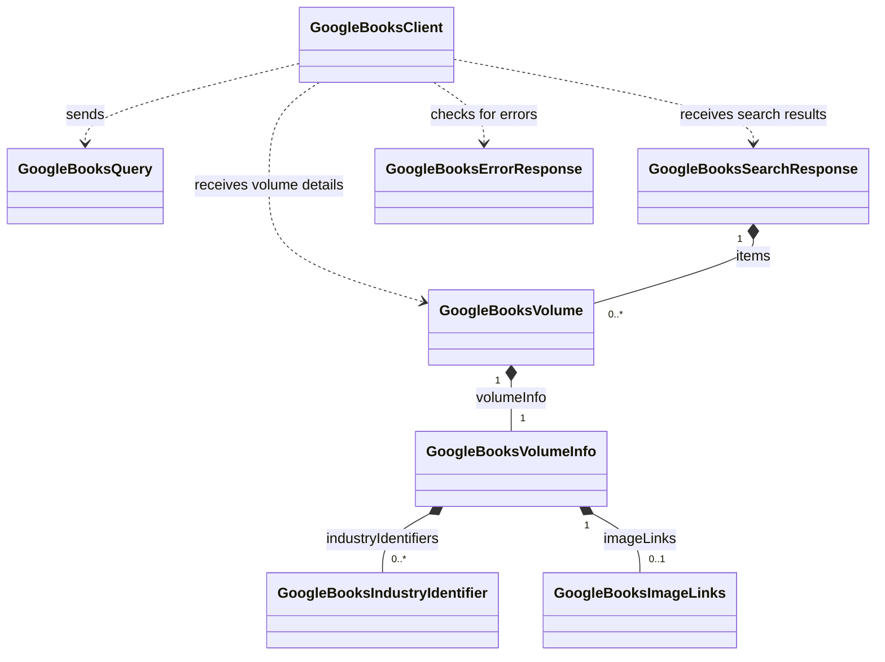

# Google Books

This feature contains the Google Books API client and the TypeScript models used for its requests and responses. The interfaces describe the subset of API data used by Chronicle; they are not runtime validators or a complete API schema.

## Model relationships

These are nested response objects, rather than separate database entities. Authors, publishers, categories, and languages are stored as strings in the volume metadata; this feature does not define separate models or relationships for them.

## Models

### `GoogleBooksSearchResponse`

The envelope returned by a volume search.

| Field | Type | Meaning |
| --- | --- | --- |
| `kind` | `"books#volumes"` | Identifies a volume collection. |
| `totalItems` | `number` | Total matches reported by the API, rather than the length of the returned page. |
| `items` | Optional `GoogleBooksVolume[]` | Volumes in this response. May be absent when there are no results. |

### `GoogleBooksVolume`

A single Google Books catalog record, identified by its Google Books `id`. Chronicle uses this ID to fetch details and retain the provider reference. The model has no separate Work and Edition entities or links between editions.

| Field | Type | Meaning |
| --- | --- | --- |
| `kind` | `"books#volume"` | Identifies a single volume. |
| `id` | `string` | Google Books volume identifier; distinct from an ISBN. |
| `etag` | `string` | API version tag for the record. |
| `selfLink` | `string` | API URL for the volume. |
| `volumeInfo` | `GoogleBooksVolumeInfo` | Required nested bibliographic metadata. |

### `GoogleBooksVolumeInfo`

The descriptive metadata belonging to one volume. Only `title` is required by this interface; every other field is optional.

| Fields | Type | Meaning |
| --- | --- | --- |
| `title`, `subtitle` | `string` | Title and optional subtitle. |
| `authors` | `string[]` | Author names, without separate author IDs or objects. |
| `publisher`, `publishedDate` | `string` | Publisher and publication date. The date remains a string and may contain only a year. |
| `description` | `string` | Description of the book. |
| `industryIdentifiers` | `GoogleBooksIndustryIdentifier[]` | Zero or more typed identifiers for this volume. |
| `pageCount` | `number` | Page count. |
| `printType` | `"BOOK"` or `"MAGAZINE"` | Publication type. |
| `categories` | `string[]` | API category labels. |
| `averageRating`, `ratingsCount` | `number` | Average rating and number of ratings. |
| `language` | `string` | Language code. |
| `imageLinks` | `GoogleBooksImageLinks` | Optional collection of cover image URLs. |
| `previewLink`, `infoLink`, `canonicalVolumeLink` | `string` | Preview and informational page URLs. |

### `GoogleBooksIndustryIdentifier`

One identifier attached to a volume through `volumeInfo.industryIdentifiers`. Both fields are required:

- `type`: `"ISBN_10"`, `"ISBN_13"`, `"ISSN"`, or `"OTHER"`.
- `identifier`: the identifier value as a string.

A volume can carry multiple identifiers. The identifier type determines how Chronicle interprets the value; the Google Books volume `id` is stored separately.

### `GoogleBooksImageLinks`

A collection of image URLs attached through `volumeInfo.imageLinks`. Its `smallThumbnail`, `thumbnail`, `small`, `medium`, `large`, and `extraLarge` fields are all optional strings. Chronicle currently reads `thumbnail` for search artwork and book artwork.

### `GoogleBooksQuery`

A request parameter map, defined as `Record<string, string | number | boolean | null | undefined>`. It is used by `GoogleBooksClient.request()` and is not part of a volume response. The client omits null, undefined, and empty-string values, converts other values to strings, and supplies the configured API key.

### `GoogleBooksErrorResponse`

An alternative response shape containing a required `error` object:

- `code`: numeric error code.
- `message`: error description.
- `errors`: optional array of details, each with required `message`, `domain`, and `reason` strings.

The client rejects unsuccessful HTTP responses and checks successful JSON responses for this error shape before returning data. `isGoogleBooksErrorResponse()` only checks whether an object has an `error` property; it does not validate the nested fields.

## Retrieval workflow

1. `search()` requests `/volumes` with an `intitle:` query and returns the response's `items` as `GoogleBooksVolume[]`. If the successful response is empty, it retries with a general query. A blank search returns an empty array.
2. `find()` searches with a maximum of one result and returns the first volume or `null`.
3. `getBook(id)` requests `/volumes/{id}` and returns a `GoogleBooksVolume`, or `null` if the request fails.
4. `findByIsbn()` canonicalizes the supplied ISBN, searches `/volumes` using `isbn:`, checks the returned ISBN-10/ISBN-13 identifiers for a canonical match, and fetches that volume's details by `id`. It returns `null` for an invalid ISBN or no matching volume.

## Relationship to Chronicle's internal models

[`GoogleBooksNormalizer`](../media/services/GoogleBooksNormalizer.ts) converts provider models into Chronicle's shared models:

| Source | Destination | Mapping |
| --- | --- | --- |
| `GoogleBooksVolume[]` | `SearchResult[]` | Title, joined author names, publication year, thumbnail, and `id` as `ids.google_library_id`; result type is `book`. |
| `GoogleBooksVolume` | `Book` | `id` becomes `gb_id`; metadata supplies title, subtitle, authors, publication date/year, pages, publisher, description, language, and artwork. |
| `industryIdentifiers` | `Book.isbn10` / `Book.isbn13` | Values are split into arrays by ISBN type; ISSN and OTHER are not mapped. |
| `volumeInfo.categories` | `Book.genres` | Provider categories become genres; Chronicle's `Book.categories` receives the Books note category. |

The normalizer uses the shared `estimateWordCount` utility with `pageCount` and the volume's categories (mapped to `genres`). It selects a book-type density, falling back to 250 words per page when classification is unknown or conflicting. `estimated_word_count` is a rough estimate, not a measured word count; missing or invalid pages yield `null` and zero pages yield zero. Enrichment recalculates it using the final pages, genres and subjects. A local artwork path is computed from the title, publication year, thumbnail, and configured image directory. Missing metadata becomes empty arrays or `null` where appropriate; `subtitle` can remain undefined. `edition`, Open Library IDs, and `first_publication_year` are set to `null`, and `subjects` is an empty array because this mapping does not supply them.
