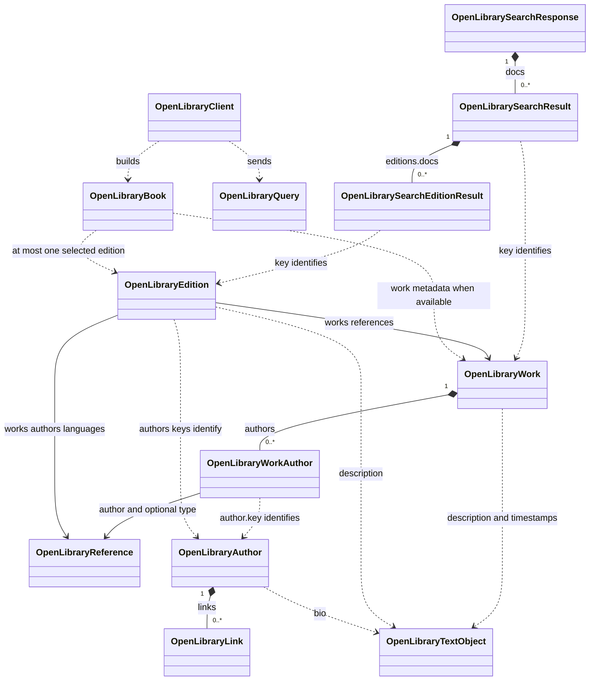

# Open Library

This feature contains the Open Library client, API response models, and a combined book model used before normalization into Chronicle's shared models. The interfaces describe the subset of data currently modeled by Chronicle; they are not runtime validators or a complete API schema. Required fields reflect local TypeScript assumptions.

## Model relationships

Open Library distinguishes a **Work** (the book as an intellectual work), an **Edition** (a particular publication), and an **Author** (a separately identified contributor). A work groups editions, while publication details such as ISBNs and publishers belong to editions. See the official [Works and Editions documentation](https://openlibrary.org/dev/docs/api/books).

Composition arrows describe nested response objects; reference arrows describe relationships through keys. Work, Edition, and Author details are fetched separately. `OpenLibraryBook` is a local flattened result assembled by the client, not an Open Library API resource or a container holding the original records.

The usual conceptual relationship is one work with many editions. The local edition interface permits an optional array of work references; the client follows the first reference when starting from an edition. Missing relationships and metadata are supported.

## Models

### `OpenLibrarySearchResponse`

The search response envelope containing `docs: OpenLibrarySearchResult[]`. The interface also models `numFound`, `num_found`, `start`, `numFoundExact`, and nullable `offset` for result counts, count precision, and pagination. The client currently consumes only `docs`.

### `OpenLibrarySearchResult`

A work-oriented search document, rather than a full `OpenLibraryWork` record. Search can include both work information and selected edition information; see the [Search API documentation](https://openlibrary.org/dev/docs/api/search).

| Fields | Type | Meaning |
| --- | --- | --- |
| `key`, `title` | Required `string` | Work identifier and search title. |
| `author_name`, `author_key` | Optional `string[]` | Contributor names and identifiers supplied by search. |
| `first_publish_year` | Optional `number` | Work's first publication year. |
| `cover_i` | Optional `number` | Cover image ID. |
| `cover_edition_key` | Optional `string` | Edition ID used as a fallback when selecting an edition. |
| `editions` | Optional object | Contains optional `docs: OpenLibrarySearchEditionResult[]`. |

### `OpenLibrarySearchEditionResult`

A nested edition search summary with required `key` and optional `title`, `isbn`, `publisher`, and `publish_date`. The latter three fields are string arrays.

The current field projection explicitly requests `editions.key` and `editions.title` along with `editions`. The client fetches the selected edition's full record before using its publication metadata; it does not assemble a book from aggregated search ISBNs or publishers.

### `OpenLibraryWork`

General metadata shared across editions. `key` and `title` are required; all other fields are optional.

| Fields | Type | Meaning |
| --- | --- | --- |
| `key` | `string` | Work path, such as `/works/OL45804W`. |
| `title` | `string` | Work title. |
| `authors` | `OpenLibraryWorkAuthor[]` | Wrapped author references. |
| `description` | `string` or `OpenLibraryTextObject` | Description in either supported representation. |
| `subjects`, `subject_people`, `subject_places`, `subject_times` | `string[]` | Subject metadata. |
| `covers` | `number[]` | Cover image IDs. |
| `first_publish_date` | `string` | First publication date, retained as text. |
| `latest_revision`, `revision` | `number` | Record revision metadata. |
| `created`, `last_modified` | `OpenLibraryTextObject` | Timestamp wrappers. |

`OpenLibraryWorkAuthor` is declared inside the work model file. It contains a required `author: OpenLibraryReference` and optional `type: OpenLibraryReference`. Consequently, a work's author key is at `authors[i].author.key`, while an edition's author key is directly at `authors[i].key`.

### `OpenLibraryEdition`

A specific publication with required `key` and `title`. All other fields are optional; `publish_date` and `number_of_pages` also explicitly allow `null`.

| Fields | Type | Meaning |
| --- | --- | --- |
| `key`, `title`, `subtitle` | `string` | Edition path (`/books/OL…M`), title, and optional subtitle. |
| `works`, `authors`, `languages` | `OpenLibraryReference[]` | References to works, contributors, and language records. |
| `description` | `string` or `OpenLibraryTextObject` | Edition description. |
| `publishers`, `publish_places` | `string[]` | Publication details. |
| `publish_date` | `string` or `null` | Publication date as supplied. |
| `number_of_pages`, `pagination` | `number` or `null`; `string` | Numeric page count and textual pagination respectively. |
| `isbn_10`, `isbn_13`, `oclc_numbers`, `lccn` | `string[]` | Edition identifiers, separate from its Open Library key. |
| `covers` | `number[]` | Cover image IDs. |
| `physical_format`, `physical_dimensions`, `weight` | `string` | Physical publication metadata. |
| `contributions`, `source_records` | `string[]` | Contribution text and source record identifiers. |
| `latest_revision`, `revision` | `number` | Record revision metadata. |

### `OpenLibraryAuthor`

A contributor record with required `key` and `name`. The remaining optional fields are:

- `alternate_names: string[]`, `personal_name`, and `fuller_name` for names.
- `birth_date` and `death_date` as strings.
- `bio` as a string or `OpenLibraryTextObject`.
- `photos: number[]` and `links: OpenLibraryLink[]`.
- `remote_ids: Record<string, string>`, `source_records: string[]`, and numeric `latest_revision` and `revision`.

The client resolves author references to names when search results do not already provide them. Individual author records are available at `/authors/{id}.json`, as described in the [Authors API documentation](https://openlibrary.org/dev/docs/api/authors).

### Supporting models

| Model | Shape | Relationship and use |
| --- | --- | --- |
| `OpenLibraryReference` | Required `key: string` | A reference to another record, such as a work, author, language, or type. It does not embed that record's details. |
| `OpenLibraryTextObject` | Required `value: string`, optional `type: string` | Alternative representation for descriptions, biographies, and work timestamps. `getOlibTextReference()` accepts a plain string or extracts `value`, returning `null` when unavailable. |
| `OpenLibraryLink` | Required `title` and `url` strings; optional `type: { key: string }` | An external link nested in an author's `links` array. Its type uses an inline reference shape. |
| `OpenLibraryQuery` | `Record<string, string \| number \| null \| undefined>` | Request parameters. The client omits null/undefined values and stringifies the rest. |

`OL_FIELDS_QUERY`, defined with `OpenLibraryQuery`, selects `key`, `title`, `author_name`, `author_key`, `first_publish_year`, `cover_i`, `cover_edition_key`, `editions`, `editions.key`, and `editions.title`.

### `OpenLibraryBook`

The client's combined result contains work metadata plus at most one selected edition. Either record may be unavailable, but at least one must exist to produce a result.

| Fields | Source and fallback |
| --- | --- |
| `key` | Work key when available; otherwise the edition key. |
| `edition_key` | Selected edition key or `null`. |
| `title`, `subtitle` | Title prefers edition, then work, then search seed, then `"Untitled"`; subtitle comes from the edition. |
| `authors` | Search seed names when nonempty; otherwise resolved edition authors, falling back to work author references when the edition has none. |
| `description` | Edition description, falling back to work description; otherwise `null`. |
| `subjects` | Work subjects or an empty array. |
| `cover_id` | First positive cover ID from edition covers, then work covers, then the search seed; otherwise `null`. |
| `first_publish_year` | Search seed year, otherwise a four-digit year extracted from the work's `first_publish_date`; otherwise `null`. |
| `publish_date`, `number_of_pages` | Selected edition values or `null`. |
| `publishers`, `isbn_10`, `isbn_13` | Selected edition arrays or empty arrays. |
| `languages` | Selected edition language keys with `/languages/` removed, or an empty array. |

Only `subtitle` is optional in this interface. Nullable fields explicitly represent unavailable values; arrays are always present. Keeping publication fields tied to one edition avoids mixing ISBNs, dates, and publishers from different publications.

## Retrieval workflow

1. **Search:** `search()` requests `/search.json` with `title`, `limit` (default 10), and `OL_FIELDS_QUERY`. It returns `docs` and retains recent search results as metadata seeds. Blank input returns an empty array.
2. **Fetch a work:** `getBook(workKey, editionKey?)` fetches `/works/{id}.json`. Its preferred edition is the explicit `editionKey`, then the first nested search edition, then `cover_edition_key`. A fetched edition is rejected if its nonempty work references do not include the requested work.
3. **Select a fallback edition:** If no edition was obtained, the client requests `/works/{id}/editions.json?limit=20`. It scores returned editions with one point each for a page count, publisher, publication date, ISBN-13, ISBN-10, and positive cover ID, then takes the highest score. Selection is limited to that response and has no language preference.
4. **Resolve contributors and combine:** If search names are unavailable, fetch author details as needed, then build `OpenLibraryBook` using the precedence above. Supplementary request failures can leave a partial result.
5. **Normalize:** Convert the combined result to Chronicle's shared `Book` model and construct a cover URL from its cover ID.

There are two alternate entry points:

- `getBook(editionKey)` fetches `/books/{id}.json`, then attempts to fetch the first referenced work.
- `findByIsbn(isbn)` removes spaces and hyphens, uppercases the input, checks its ISBN-shaped format, and requests `/isbn/{isbn}.json`. It combines that edition with its first referenced work when available. This format check does not validate an ISBN checksum.

Keys accepted by the client may be bare IDs or work/book/author paths, with an optional `.json` suffix. HTTP 404 becomes `null`; other HTTP failures and network failures throw, except where a supplementary fetch is explicitly handled as optional. Responses are cached for five minutes, and identical in-flight requests are shared.

## Relationship to Chronicle's internal models

[`OpenLibraryNormalizer`](../media/services/OpenLibraryNormalizer.ts) maps the provider models into shared models:

| Source | Destination | Mapping |
| --- | --- | --- |
| `OpenLibrarySearchResult[]` | `SearchResult[]` | Prefer the first nested edition title; retain the work key and preferred edition key separately; use author names, first publication year, and search cover ID. |
| `OpenLibraryBook.key` | `Book.olib_id` | Retained only when it is a work path; edition-only results leave this `null`. |
| `OpenLibraryBook.edition_key` | `Book.olib_edition_id`, `Book.edition` | Selected edition path. |
| `publish_date`, `first_publish_year` | `publication_date`, `publication_year`, `first_publication_year` | Preserve the edition date, extract its four-digit year, and keep the work's first publication year separately. |
| `number_of_pages`, `isbn_10`, `isbn_13`, `description` | `pages`, `isbn10`, `isbn13`, `overview` | Direct mappings. |
| `authors`, `publishers`, `subjects`, `languages` | Corresponding `Book` arrays | Direct mappings; language codes remain as supplied after removing the reference prefix. |
| `cover_id` | `artwork`, `artwork_local` | Build `https://covers.openlibrary.org/b/id/{coverId}-L.jpg` and compute a local artwork path. |

The normalizer also copies title/subtitle, sets Chronicle's Books note category, leaves `genres` empty, and sets `gb_id` to `null`. The shared `estimateWordCount` utility uses `number_of_pages` and subjects to select a book-type density, falling back to 250 words per page when classification is unknown or conflicting. `estimated_word_count` is a rough estimate, not a measured word count; missing or invalid pages yield `null` and zero pages yield zero. Enrichment recalculates it using the final pages, genres and subjects. The local artwork filename uses the edition's publication year when available, otherwise the work's first publication year.
